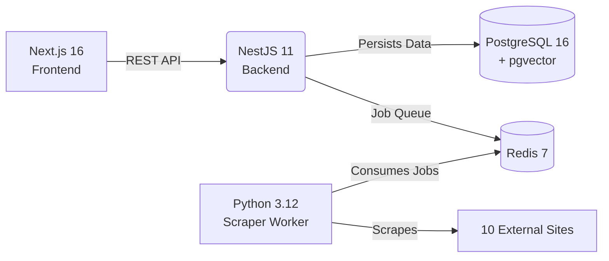

<div align="center">
  
  
  # 🎓 Udemy Course Finder
  
  **Your personal, automated aggregator for 100% free Udemy courses.**
  
  [](https://nestjs.com/)
  [](https://nextjs.org/)
  [](https://www.python.org/)
  [](https://postgresql.org/)
  [](https://docker.com/)

</div>

---

## ✨ Overview

**Udemy Course Finder** is a self-hosted application that continuously discovers free, English-language Udemy courses by scraping **10 coupon websites**. It normalizes the results through a 6-stage data pipeline, deduplicates them, and presents them in a modern, mobile-responsive dashboard with AI-powered semantic search.

Never manually search coupon sites again—let the Python worker do the heavy lifting in the background while you browse a clean, ad-free interface.

---

## 🏗️ Architecture



**Data flow:** Backend enqueues scrape jobs ➔ Python worker scrapes 10 sites ➔ Pipeline: Normalize ➔ Validate ➔ Language-Filter ➔ Deduplicate ➔ Store to PostgreSQL ➔ Backend generates vector embeddings ➔ Frontend fetches via API.

---

## 📖 Installation & Setup Guide

### 📋 Prerequisites

Before installing, ensure your host environment has:
- **Node.js**: v18.x or v20+ (`node -v`)
- **npm**: v9+ (`npm -v`)
- **Python**: 3.10+ (`python3 --version`)
- **C/C++ Build Tools** (required for compiling native packages `argon2`, `better-sqlite3`, and native bindings for `onnxruntime-node`):
  - **Linux (Debian/Ubuntu)**: `sudo apt update && sudo apt install -y build-essential` *(install `python3` too if not already installed)*
  - **macOS**: `xcode-select --install`
  - **Windows**: `npm install --global windows-build-tools` or install Visual Studio C++ Build Tools.
- *(Optional for Production Mode)*: **Docker & Docker Compose**

---

### 🚀 Step-by-Step Installation

#### 1️⃣ Clone the Repository

```bash
git clone https://github.com/Akai-Abd/udemy-course-finder.git
cd udemy-course-finder
```

#### 2️⃣ Choose Setup Mode

---

#### Mode A: Standalone Local Setup (SQLite — Recommended for Development)

No Docker, PostgreSQL, or Redis required.

**Step 1: Set up Backend**
```bash
cd backend
cp .env.example .env
npm install

# 1. Allow npm v10+ lifecycle scripts
npm install-scripts approve --all

# 2. Rebuild ONNX native binary for local AI embeddings
npm rebuild onnxruntime-node

npx prisma generate                # Generate Prisma Client types
npm run build                      # Verify build output

# 3. Start backend (requires active internet for 1st model download)
npm run start:sqlite
```
> `npm run start:sqlite` automatically sets `DATABASE_URL="file:./dev.db"` and `ENABLE_REDIS="false"`, syncs the SQLite database, seeds default categories/admin, and starts NestJS at `http://localhost:4000`.

> [!NOTE]
> On first launch, NestJS initializes a local Hugging Face embedding pipeline (`Xenova/all-MiniLM-L6-v2`) for semantic search. Ensure active internet connection on initial startup to download the ~90MB ONNX model. If you get `Failed to initialize embedding pipeline`, run `npm install-scripts approve --all && npm rebuild onnxruntime-node`.

**Step 2: Set up Frontend (in a new terminal)**
```bash
cd frontend
cp .env.example .env
npm install
npm install-scripts approve --all  # Approve lifecycle scripts (npm v10+)
npm run build                      # Build Next.js production bundle
npm run dev                        # Or npm run start for production server
```
> Frontend will open at `http://localhost:3000` connected to `http://localhost:4000`.

---

#### Mode B: Docker Compose (PostgreSQL + Redis — Full Stack)

```bash
# Copy root environment variables
cp .env.example .env

# Build and start all 5 containers
docker compose up -d
```
> Services will be available at:
> - **Frontend Dashboard**: `http://localhost:3001`
> - **Backend API & Swagger**: `http://localhost:4001/api`

---

### 🔑 Default Credentials

- **Admin Email**: `admin@localhost.local`
- **Admin Password**: `ChangeMe123!`

---

### ❓ Troubleshooting & Common Issues

#### 1️⃣ Port Conflict (`EADDRINUSE: address already in use :::4000` or `:::3000`)
- **Root Cause**: An existing NestJS backend, Next.js frontend, or zombie process is already using port `4000` or `3000`.
- **Solution**: Free up the port using `fuser` or `npx kill-port`:
  ```bash
  # Free up Backend port 4000
  fuser -k 4000/tcp  # Or: npx kill-port 4000

  # Free up Frontend port 3000
  fuser -k 3000/tcp  # Or: npx kill-port 3000
  ```

#### 2️⃣ `Cannot GET /` on `http://localhost:4000`
- **Root Cause**: NestJS is a headless REST API server and does not render HTML on the root `/` path.
- **Solution**:
  - **Swagger API Docs & Testing UI**: Navigate to [http://localhost:4000/api](http://localhost:4000/api)
  - **User Dashboard**: Navigate to [http://localhost:3000](http://localhost:3000)

#### 3️⃣ `❌ Failed to initialize embedding pipeline`
- **Root Cause**: npm v10+ blocked native postinstall scripts (`onnxruntime-node`), or host machine had no internet access to download the ~90MB Hugging Face ONNX model on initial start.
- **Solution**: Run the approval and rebuild commands in `backend/`:
  ```bash
  cd backend
  npm install-scripts approve --all
  npm rebuild onnxruntime-node
  ```

## 🛠️ Troubleshooting & Known Issues

If you encounter issues during installation or runtime, refer to the resolutions below:

<details>
<summary><b>1. PrismaClientInitializationError / Environment Variable Missing</b></summary>

- **Symptom**: `Environment variable not found: DATABASE_URL` or `secretOrPrivateKey must have a value`.
- **Cause**: `.env` file not created in backend/frontend directory.
- **Fix**: Run `cp .env.example .env` inside both `backend/` and `frontend/`.
</details>

<details>
<summary><b>2. Database Connection Failure (P1001: Can't reach database server at 5432)</b></summary>

- **Symptom**: `P1001: Can't reach database server at localhost:5432`.
- **Cause**: Prisma default schema uses PostgreSQL when Postgres is not running.
- **Fix**: For local development without Postgres, run `npm run start:sqlite` inside `backend/`.
</details>

<details>
<summary><b>3. Redis ECONNREFUSED Error</b></summary>

- **Symptom**: `[IORedis] Error: connect ECONNREFUSED 127.0.0.1:6379`.
- **Cause**: Redis service is not active locally.
- **Fix**: Ensure `ENABLE_REDIS="false"` is set in `backend/.env` for standalone execution.
</details>

<details>
<summary><b>4. Missing Compiled Seed File (MODULE_NOT_FOUND dist/prisma/seed.js)</b></summary>

- **Symptom**: `Cannot find module '.../dist/prisma/seed.js'`.
- **Cause**: Seeding before compiling the NestJS build output.
- **Fix**: Updated seed execution to use `ts-node prisma/seed.ts` via `npm run db:sqlite:setup` or `npx prisma db seed`.
</details>

<details>
<summary><b>5. Native Module Compilation Error (node-gyp / make error)</b></summary>

- **Symptom**: `gyp ERR! stack Error: make failed with exit code: 2` during `npm install`.
- **Cause**: Missing C/C++ compiler for `argon2` / `better-sqlite3`.
- **Fix**: Install OS build tools (`build-essential` on Linux, Xcode command line tools on macOS).
</details>

<details>
<summary><b>6. CORS Error or Frontend API Request Blocked</b></summary>

- **Symptom**: `Access to fetch at ... has been blocked by CORS policy`.
- **Cause**: Port mismatch between `BACKEND_PORT` and `NEXT_PUBLIC_API_URL`.
- **Fix**: Ensure `BACKEND_PORT=4000` and `NEXT_PUBLIC_API_URL=http://localhost:4000` match in `.env`.
</details>

<details>
<summary><b>7. Interactive Database Push Confirmation Prompt</b></summary>

- **Symptom**: Terminal prompts `There might be data loss... Do you want to continue? (y/N)` when running `npm run start:sqlite`.
- **Cause**: `prisma db push` prompts for user confirmation if non-destructive changes cannot be made automatically or if SQLite `dev.db` schema changes.
- **Fix**: Type `y` and press `Enter` to allow Prisma to sync the local SQLite `dev.db` schema.
</details>

<details>
<summary><b>8. npm warn install-scripts (Blocked Package Scripts)</b></summary>

- **Symptom**: `npm warn install-scripts 7 packages have install scripts blocked...`
- **Cause**: npm v10/v11+ restricts execution of package lifecycle scripts (`sharp`, `onnxruntime-node`, etc.) by default.
- **Fix**: Run `npm install-scripts approve --all` inside `backend/` and `frontend/`.
</details>

<details>
<summary><b>9. TypeScript Errors: Module '"@prisma/client"' has no exported member 'PrismaClient' / Property 'X' does not exist on type 'PrismaService'</b></summary>

- **Symptom**: TS2305 and TS2339 errors during `npm run build`.
- **Cause**: Prisma Client artifacts have not been generated yet.
- **Fix**: Run `npx prisma generate` inside `backend/`.
</details>

<details>
<summary><b>10. Frontend "Network Error" on Login or API Requests</b></summary>

- **Symptom**: Browser or dashboard displays `Network Error` when attempting login or fetching courses.
- **Cause**: Backend server is not running on port 4000, or `NEXT_PUBLIC_API_URL` environment variable was updated while Next.js dev server was active.
- **Fix**:
  1. Ensure NestJS backend is running via `npm run start:sqlite` or `npm run start:dev` inside `backend/`.
  2. Verify `NEXT_PUBLIC_API_URL=http://localhost:4000` is set in `frontend/.env`.
  3. Restart Next.js dev server (`Ctrl+C` and run `npm run dev`) so environment variables reload.
</details>

<details>
<summary><b>11. Embedding Pipeline Initialization Error</b></summary>

- **Symptom**: `ERROR: ❌ Failed to initialize embedding pipeline:` on backend startup.
- **Cause**: Native bindings for `onnxruntime-node` were blocked during install or require rebuilding.
- **Fix**: Run `npm rebuild onnxruntime-node` inside `backend/`.
</details>

---

## ✨ Features

- **🔍 Smart Search** — Full-text search + AI-powered semantic search (pgvector + HuggingFace embeddings)
- **🤖 Recommendations** — Personalized course suggestions based on browsing history
- **📊 Analytics Dashboard** — Time-series charts, category breakdowns, provider stats
- **⭐ Favorites & History** — Save courses and track your browsing activity
- **🕷️ 10 Scrapers** — Modular scraper architecture with a 6-stage data pipeline
- **⏰ Auto-Scheduling** — Configurable scrape interval with BullMQ job queue
- **✅ Coupon Validation** — Periodic verification of active coupons against Udemy
- **🔐 Secure Auth** — JWT with refresh tokens, Argon2 hashing, Redis token blacklist
- **👥 Admin Panel** — Role-based access control with user management
- **🔔 Notifications** — Real-time in-app notification system
- **📱 Mobile Responsive** — Fully responsive UI with mobile drawer navigation
- **📖 Swagger Docs** — Full OpenAPI documentation at `/api`
- **🐳 Docker Ready** — One-command deployment with Docker Compose
- **🗃️ Dual Database** — Production PostgreSQL + lightweight SQLite for local dev

---

## 🛠️ Tech Stack

<div align="center">

| Component | Technologies Used | Highlight |
| :--- | :--- | :--- |
| **🎨 Frontend** | Next.js 16, React 19, TailwindCSS 4 | TanStack Query, Recharts, shadcn/ui, mobile responsive |
| **⚙️ Backend** | NestJS 11, Prisma 7, Passport JWT | BullMQ, Swagger API Docs, Pino Logging |
| **🕷️ Scraper** | Python 3.12, BeautifulSoup, requests | 6-stage pipeline, deduplication, proxy rotation |
| **🗄️ Database** | PostgreSQL 16 + pgvector / SQLite | Vector search, relational data, indexing |
| **⚡ Cache/Queue**| Redis 7 | BullMQ job orchestration, token blacklist, caching |

</div>

---

## 🌐 Supported Coupon Sources

The scraper engine currently supports the following **10 providers** (with modular architecture to add more):

| # | Provider | Base URL |
|---|----------|----------|
| 1 | Coupon Scorpion | `couponscorpion.com` |
| 2 | CourseJoiner | `coursejoiner.com` |
| 3 | Courson | `courson.xyz` |
| 4 | DiscUdemy | `discudemy.com` |
| 5 | E-next | `e-next.in` |
| 6 | Freebies Global | `freebiesglobal.com` |
| 7 | FreeWebCart | `freewebcart.com` |
| 8 | iDownloadCoupons | `idownloadcoupon.com` |
| 9 | Real Discount | `real.discount` |
| 10 | Udemy Freebies | `udemyfreebies.com` |

---

## 🔌 API Endpoints

The backend exposes a full REST API (Swagger docs at `http://localhost:4000/api`):

| Module | Endpoints | Description |
|--------|-----------|-------------|
| **Auth** | `POST /auth/login`, `refresh`, `logout`, `PATCH /auth/password` | JWT authentication with refresh tokens |
| **Courses** | `GET /courses`, `search`, `search/semantic`, `recommendations`, `stats`, `:id/similar` | Browse, search, AI-powered semantic search |
| **Providers** | `GET /providers`, `PATCH :id`, `POST scrape`, `POST :id/test`, `:id/logs`, `:id/stats` | Manage scraper sources |
| **Favorites** | `GET /favorites`, `POST`, `DELETE :courseId` | Save/remove favorite courses |
| **History** | `GET /history`, `POST`, `DELETE` | Track browsing activity |
| **Analytics** | `GET /analytics/overview`, `time-series` | Dashboard analytics |
| **Categories** | `GET /categories` | 13 seeded course categories |
| **Settings** | `GET /settings/:key`, `PATCH :key` | App configuration |
| **Users** | `GET /users`, `PATCH :id/role`, `DELETE :id` | Admin user management |
| **Notifications** | `GET /notifications`, `PATCH :id/read`, `POST :id/dismiss` | In-app notifications |

---

## 💻 Development Setup

<details>
<summary><b>Click to expand full development instructions</b></summary>

### Prerequisites
* Node.js 20+
* Python 3.12+

**For Docker mode additionally:**
* PostgreSQL 16 (with pgvector extension)
* Redis 7

### Option A: SQLite (No Docker Required)

```bash
# Backend (uses local dev.db)
cd backend
npm install
npm run start:sqlite
# API at http://localhost:4000, Swagger at http://localhost:4000/api

# Frontend
cd frontend
npm install
npm run dev
# Dashboard at http://localhost:3000
```

### Option B: Docker Compose (Full Stack)

```bash
cp .env.example .env
# Edit .env with your secrets
docker compose up -d
# Frontend at http://localhost:3001, API at http://localhost:4001/api
```

### Python Scraper (Standalone)
```bash
cd scraper
python -m venv .venv && source .venv/bin/activate
pip install -r requirements.txt
python -m src.main
```

</details>

<details>
<summary><b>Click to view Testing commands</b></summary>

```bash
# Backend unit tests
cd backend && npm test

# Backend unit tests with coverage
cd backend && npm run test:cov

# Backend E2E tests
cd backend && npm run test:e2e

# Scraper tests
cd scraper && python -m pytest tests/ -v

# Frontend type check
cd frontend && npx tsc --noEmit && npm run lint
```
</details>

---

## 📁 Project Structure

```text
udemy-course-finder/
├── backend/                  # NestJS API server
│   ├── src/
│   │   ├── auth/             # JWT authentication, token blacklist
│   │   ├── courses/          # Course CRUD, search, semantic search
│   │   ├── providers/        # Provider management, scrape triggers
│   │   ├── favorites/        # User favorites
│   │   ├── history/          # Browsing history tracking
│   │   ├── analytics/        # Dashboard analytics
│   │   ├── categories/       # Course categories
│   │   ├── jobs/             # BullMQ job scheduling
│   │   ├── embeddings/       # HuggingFace vector embeddings
│   │   ├── notifications/    # In-app notification system
│   │   ├── users/            # Admin user management (RBAC)
│   │   ├── settings/         # App settings
│   │   └── common/           # Guards, filters, decorators, cache
│   ├── prisma/               # Schema (PostgreSQL + SQLite), migrations, seed
│   └── test/                 # E2E tests
├── frontend/                 # Next.js dashboard
│   └── src/
│       ├── app/              # App Router pages + custom favicon & branding
│       ├── components/       # UI components (shadcn/ui, analytics, layout, shared)
│       └── lib/              # API client, hooks, utilities
├── scraper/                  # Python scraping worker
│   └── src/
│       ├── providers/        # 10 scraper implementations
│       ├── pipeline/         # normalize → validate → filter → dedup → store
│       └── utils/            # HTTP client, URL parser, logging
├── docker-compose.yml        # Service orchestration (5 containers)
├── docker-compose.override.yml # Dev mode overrides (hot reload)
└── .env.example              # Environment configuration template
```

---

## ⚙️ Environment Variables

Key configuration (see `.env.example` for all options):

| Variable | Description | Default |
|----------|-------------|---------|
| `POSTGRES_PASSWORD` | Database password | *(must change)* |
| `JWT_SECRET` | Access token signing key (≥32 chars) | *(must change)* |
| `JWT_REFRESH_SECRET` | Refresh token signing key | *(must change)* |
| `SCRAPE_INTERVAL_MINUTES` | Auto-scrape frequency | `30` |
| `SCRAPE_DELAY_SECONDS` | Delay between HTTP requests | `2` |
| `NEXT_PUBLIC_API_URL` | Frontend → Backend URL | `http://localhost:4001` |
| `DEFAULT_ADMIN_EMAIL` | Initial admin email | `admin@localhost.local` |
| `DEFAULT_ADMIN_PASSWORD` | Initial admin password | `ChangeMe123!` |

---

<div align="center">
  
  *Built by ABDURRAHMAN ❤️ for lifelong learners.*
  
  **[MIT License](LICENSE)**
</div>
