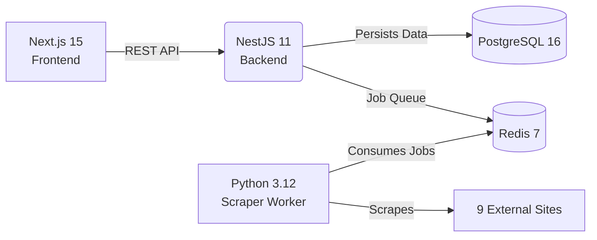

<div align="center">
  
  
  # 🎓 Udemy Course Finder
  
  **Your personal, automated aggregator for 100% free Udemy courses.**
  
  [](https://nestjs.com/)
  [](https://nextjs.org/)
  [](https://www.python.org/)
  [](https://postgresql.org/)
  [](https://docker.com/)

</div>

---

## ✨ Overview

**Udemy Course Finder** is a localhost-only application that continuously discovers free, English-language Udemy courses by scraping a curated set of coupon websites. It normalizes the results, deduplicates them, and presents them in a beautiful, modern dashboard. 

Never manually search coupon sites again—let the Python worker do the heavy lifting in the background while you browse a clean, ad-free interface.

---

## 🏗️ Architecture

The application is built on a robust, microservice-inspired architecture running entirely within Docker:



**Data flow:** Backend enqueues scrape jobs ➔ Python worker scrapes 9 sites ➔ Pipeline: Normalize ➔ Validate ➔ Language-Filter ➔ Deduplicate ➔ Store to PostgreSQL ➔ Frontend fetches via API.

---

## 🚀 Quick Start

Get the entire stack running in less than 5 minutes using Docker Compose.

```bash
# 1. Clone the repository
git clone https://github.com/Akai-Abd/udemy-course-finder.git
cd udemy-course-finder

# 2. Copy environment variables
cp .env.example .env

# 3. Start all services in the background
docker compose up -d

# 4. Run database migrations & seed initial data
docker compose exec backend npx prisma migrate deploy
docker compose exec backend npx prisma db seed
```

🎉 **You're done!** Open [http://localhost:3000](http://localhost:3000) in your browser.

> **Default Admin Credentials:**
> - **Email:** `admin@localhost.local`
> - **Password:** `ChangeMe123!`

---

## 🛠️ Tech Stack & Features

<div align="center">

| Component | Technologies Used | Highlight |
| :--- | :--- | :--- |
| **🎨 Frontend** | Next.js 15, React 19, TailwindCSS 4 | TanStack Query, Recharts, shadcn/ui |
| **⚙️ Backend** | NestJS 11, Prisma 7, Passport JWT | BullMQ, Swagger API Docs, Pino Logging |
| **🕷️ Scraper** | Python 3.12, BeautifulSoup, httpx | Concurrent processing, deduplication pipeline |
| **🗄️ Database** | PostgreSQL 16 | Relational data, rapid search indexing |
| **⚡ Cache/Queue**| Redis 7 | BullMQ job orchestration, fast stat caching |

</div>

---

## 🌐 Supported Coupon Sources

The scraper engine currently supports the following **10 primary providers** (with modular architecture to add more):

1. `Coupon Scorpion`
2. `Course Joiner`
3. `Courson`
4. `Discudemy`
5. `Enext`
6. `Freebies Global`
7. `FreeWebCart`
8. `iDownloadCoupons`
9. `Real Discount`
10. `Udemy Freebies`

---

## 💻 Development Setup

Want to run the services locally without Docker for development?

<details>
<summary><b>Click to expand development instructions</b></summary>

### Prerequisites
* Node.js 20+
* Python 3.12+
* PostgreSQL 16
* Redis 7

### 1. Backend API
```bash
cd backend
npm install
npx prisma generate
npx prisma migrate dev
npm run start:dev
```
*Swagger UI is available at `http://localhost:4000/api`*

### 2. Frontend Dashboard
```bash
cd frontend
npm install
npm run dev
```

### 3. Python Scraper
```bash
cd scraper
pip install -r requirements.txt
python -m src.worker
```

</details>

<details>
<summary><b>Click to view Testing commands</b></summary>

```bash
# Backend unit tests
cd backend && npm test

# Backend unit tests with coverage
cd backend && npm run test:cov

# Backend E2E tests
cd backend && npm run test:e2e

# Scraper tests
cd scraper && python -m pytest tests/ -v

# Frontend lint + type check
cd frontend && npx tsc --noEmit && npm run lint
```
</details>

---

## 📁 Project Structure

```text
udemy-course-finder/
├── backend/              # 🟢 NestJS API server (Auth, CRUD, Jobs, Analytics)
├── frontend/             # 🔵 Next.js dashboard (App Router, UI Components)
├── scraper/              # 🐍 Python scraping worker (Pipelines, Extractors)
├── docker-compose.yml    # 🐳 Service orchestration
└── .env.example          # 🔑 Environment template
```

---

<div align="center">
  
  *Built By Akai ❤️ for lifelong learners.*
  
  **UNLICENSED — Personal use only.**
</div>
